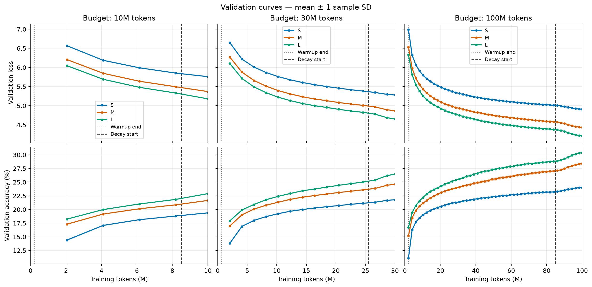
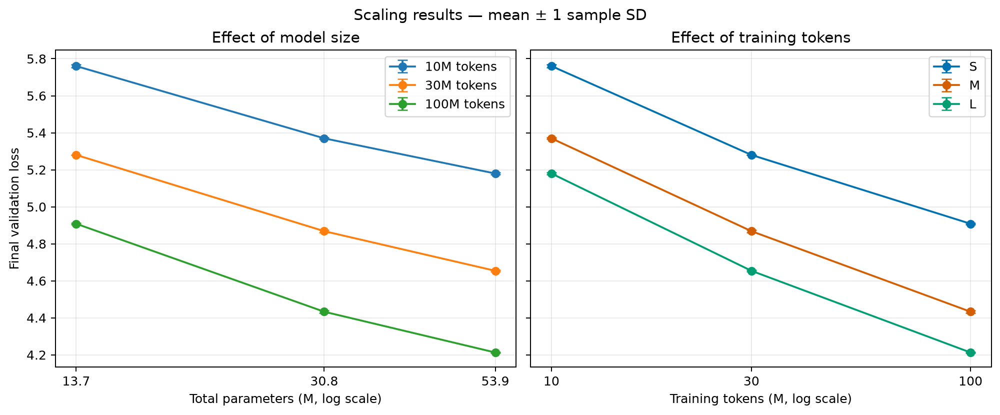

# OWT Scaling 实验记录

本轮比较三档模型在不同训练 token 预算下的验证效果，共完成 **3 种模型 × 3 个预算 × 3 个 seed = 27 次独立训练**。

在当前设置和预算范围内，增加模型参数量、增加训练 tokens 都改善了最终验证 loss 和 accuracy。100M tokens 下，S、M、L 的平均验证 loss 分别为 **4.9084、4.4331、4.2128**。

## 实验设置

配置入口为 [exp_scaling.py](exp_scaling.py)。每次运行从头初始化模型和优化器，预算之间不共享训练状态。

| 设置 | 取值 |
|---|---|
| 数据集 | OpenWebText（OWT），预处理目录 `data/processed/owt-gpt2` |
| Tokenizer | GPT-2，词表大小 50,257 |
| Token 文件格式 | `<u2`，每个 token 占 2 字节 |
| 训练 seed | 42、43、44，控制模型初始化和训练窗口采样 |
| 验证 seed | 固定为 2026 |
| Batch size / context length | 8 / 256，每步 2,048 个训练 tokens |
| 优化器 | AdamW，betas=(0.9, 0.999)，eps=1e-8，weight decay=0.01 |
| 基础学习率 | 3e-4 |
| 调度 | WSD：warmup 占约 2%，最后约 15% 进行余弦衰减，最低学习率为基础值的 10% |
| 训练日志 | 每 100 步记录，结束时补记剩余区间 |
| 验证 | 每 1,000 步及训练结束时执行；每次 128 个 batch，共 262,144 个 tokens |

训练采用固定长度窗口，窗口在每个 epoch 内打乱后无放回取样，不足一个完整 batch 的尾部窗口被丢弃。

验证每次重置为同一个采样 seed，在相同验证数据和 batch 设置下评估相同的窗口序列；这些窗口是抽样得到的，可能重复，指标不代表完整验证集评估。

模型使用 RoPE、RMSNorm 和 SwiGLU，输入 embedding 与输出 lm_head 不共享权重。

| 模型 | 层数 | d_model | 注意力头数 | d_ff | 总参数量 | 主体参数量 |
|---|---:|---:|---:|---:|---:|---:|
| S | 4 | 128 | 4 | 384 | 13,718,912 | 853,120 |
| M | 6 | 256 | 8 | 768 | 30,846,720 | 5,115,136 |
| L | 8 | 384 | 12 | 1,152 | 53,939,328 | 15,341,952 |

主体参数量为 `transformer_blocks + ln_final`；总参数量还包括 `tok_emb + lm_head`。Scaling 图的参数轴使用总参数量。

预算通过完整训练步实现，因此实际训练 tokens 略高于计划值：

| 计划预算 | 训练步数 | 实际训练 tokens | Warmup 结束（M tokens） | Decay 开始（M tokens） |
|---|---:|---:|---:|---:|
| 10M | 4,883 | 10,000,384 | 0.200704 | 8.499200 |
| 30M | 14,649 | 30,001,152 | 0.600064 | 25.499648 |
| 100M | 48,829 | 100,001,792 | 2.000896 | 85.000192 |

## 最终验证结果

每次运行取最后一次验证结果，再按模型与预算分组。表中为三个 seed 的**均值 ± 样本标准差**（ddof=1）。Accuracy 以百分比表示，标准差单位为百分点；PPL 先按每次运行的 `exp(val_loss)` 计算，再进行分组统计。

| 模型 | 预算 | Validation loss ↓ | Accuracy (%) ↑ | PPL ↓ |
|---|---|---:|---:|---:|
| S | 10M | 5.7605 ± 0.0083 | 19.38 ± 0.06 | 317.50 ± 2.65 |
| S | 30M | 5.2802 ± 0.0008 | 21.78 ± 0.02 | 196.42 ± 0.16 |
| S | 100M | 4.9084 ± 0.0041 | 24.02 ± 0.05 | 135.42 ± 0.56 |
| M | 10M | 5.3699 ± 0.0048 | 21.66 ± 0.05 | 214.85 ± 1.04 |
| M | 30M | 4.8684 ± 0.0068 | 24.62 ± 0.07 | 130.11 ± 0.89 |
| M | 100M | 4.4331 ± 0.0056 | 28.41 ± 0.10 | 84.19 ± 0.47 |
| L | 10M | 5.1799 ± 0.0045 | 22.90 ± 0.01 | 177.67 ± 0.80 |
| L | 30M | 4.6542 ± 0.0046 | 26.47 ± 0.01 | 105.03 ± 0.48 |
| L | 100M | 4.2128 ± 0.0018 | 30.42 ± 0.06 | 67.54 ± 0.12 |

## 图表与观察

以下图表由 [analyze.py](../analyze.py) 生成。

---
**验证趋势图**

验证趋势图两行分别为 loss 和 accuracy，三列分别为 10M、30M、100M 预算。

趋势图横轴为累计训练 tokens，实线和阴影分别表示跨 seed 的均值和一个样本标准差；竖直点线表示 warmup 结束，虚线表示 decay 开始。

---
**Scaling 对比图**

Scaling 对比图中，左图固定预算比较总参数量，右图固定模型比较实际训练 tokens；横轴使用对数刻度。

---
**观察结果**

在当前的预算内，可以观察到：

1. **训练整体稳定。** 验证 loss 整体下降，accuracy 整体上升，没有明显发散。
2. **相同预算下，大模型的验证效果更好。** 三个预算均有 `loss(L) < loss(M) < loss(S)`，accuracy 排名相反。
3. **相同模型下，更多训练 tokens 带来收益。** 三档模型从 10M 到 30M、再到 100M 均有改善。L 在 30M 时的 loss 为 4.6542，优于 S 在 100M 时的 4.9084，说明在这些设置下大模型达到相近效果需要更少训练 tokens。
4. **末段改善与学习率衰减位置吻合。** 30M 和 100M 曲线在衰减阶段出现较明显的进一步改善；尚无调度对照实验，不能单独量化学习率衰减的贡献。